# Treasure Hunt – Evolutionary Programming

Assignment 2b for *Umelá inteligencia* (FIIT STU). A treasure hunter walks on a grid and has to collect every treasure.
The walk is not searched for directly: an evolutionary algorithm evolves **programs for a small virtual machine**, and
each program's output is the sequence of moves.

```text
. . ↓ ← . . .      S  start          @  hunter (end of the path)
. . ↓ ↑ $ ← ←      T  treasure       $  treasure found
. . $ ← ← ↑ .      ↑↓←→  last direction the hunter left this cell in
. → ↓ ↑ . ↑ $
. @ ← → → ↑ ←
. . . ↑ $ → ↑
. . . S . . .
```

## Contents

- [Quick start](#quick-start)
- [Project structure](#project-structure)
- [How it works](#how-it-works)
  - [Grid](#grid)
  - [Virtual machine](#virtual-machine)
  - [Fitness](#fitness)
  - [Evolutionary algorithm](#evolutionary-algorithm)
- [Usage](#usage)
- [Output](#output)
- [Logging runs](#logging-runs)
- [Experiments and plots](#experiments-and-plots)
- [Comparison of methods](#comparison-of-methods)
- [Best configuration](#best-configuration)
- [Design notes](#design-notes)

## Quick start

Requires [uv](https://docs.astral.sh/uv/) (Python 3.12 is installed automatically).

```sh
uv sync                                     # create .venv and install pandas + matplotlib
uv run project2.py                          # solve grid.txt with default settings
uv run project2.py --selection tournament --crossover two_point --seed 42
uv run plot.py runs.csv                     # graphs from every logged run
```

`project2.py` uses only the standard library, so `python3 project2.py` works without uv as well.
Only `plot.py` needs `pandas` and `matplotlib`.

## Project structure

| File | Purpose |
| --- | --- |
| `project2.py` | Grid, virtual machine, evolutionary algorithm, command-line interface |
| `plot.py` | Graphs and a summary table from the logged runs |
| `experiment.py` | Runs the best configuration next to the default on new seeds ([Best configuration](#best-configuration)) |
| `compare.py` | Compares every method against the default settings ([Comparison of methods](#comparison-of-methods)) |
| `grid.txt` | The default map from the assignment (7×7, 5 treasures) |
| `runs.csv` | Log of all runs, one row per generation (created by `project2.py`) |
| `experiments/` | Logs and summary tables written by `compare.py` and `experiment.py` |
| `plots/` | Graphs: `plots/*.png` from `experiment.py`, `plots/<comparison>/` from `compare.py` |
| `pyproject.toml`, `uv.lock` | Project metadata and pinned dependencies |

## How it works

### Grid

The map is a plain text file. Each character is one cell:

| Character | Meaning |
| --- | --- |
| `S` | start – exactly one |
| `T` | treasure – at least one |
| anything else (`.`) | empty cell |

The width is the longest line and empty lines at the end are ignored. The hunter moves **H** (up), **D** (down),
**P** (right) and **L** (left). A treasure counts as found only when the hunter stands on its cell.

### Virtual machine

The machine has **64 memory cells of 1 byte**. Instructions and data share the same memory, so programs can modify
themselves. Every byte is a valid instruction:

| Instruction | Encoding | Effect |
| --- | --- | --- |
| `INC a` | `00aaaaaa` | `mem[a] += 1` (wraps 255 → 0) |
| `DEC a` | `01aaaaaa` | `mem[a] -= 1` (wraps 0 → 255) |
| `JMP a` | `10aaaaaa` | continue at address `a` |
| `WRT a` | `11aaaaaa` | output a move from the **last two bits** of `mem[a]` |

`WRT` maps the last two bits of the cell to a direction:

| Last two bits | `00` | `01` | `10` | `11` |
| --- | --- | --- | --- | --- |
| Move | H ↑ | D ↓ | P → | L ← |

`INC` and `DEC` change the whole byte. Incrementing `00111111` gives `01000000`, so an `INC` can turn into a `DEC`.

Execution starts at address 0. A program stops when any of these happens:

1. the hunter has found all treasures,
2. the hunter steps off the grid,
3. 500 instructions have been executed,
4. execution runs past the last cell (address 63) – unless `--wrap` is set, which continues from address 0 instead.

### Fitness

```text
fitness = treasures found + 1 − 0.001 × moves
```

Treasures always matter most. Among programs that find the same number, the shorter path wins.
For example `5.960` means all 5 treasures in 40 moves. Fitness lies between 0.5 and about 6.

A program that never moves gets the lowest fitness, `1 − 0.001 × 500 = 0.5`. Otherwise doing nothing (fitness 1.0)
would beat a program that explores but finds nothing yet (e.g. 0.999).

### Evolutionary algorithm

An **individual** is a list of 64 bytes – the initial memory of the machine. Every evaluation copies the individual
into the machine, so the self-modifying run never changes the original genes.

1. **Initialization.** `--pop-size` individuals. The first `--init-cells` cells are random bytes (0–255), the rest
   are zero.
2. **Evaluation.** Every individual is run on the machine and gets a fitness.
3. **Stop check.** If the best individual found all treasures, its program and path are printed and the run ends
   (with `--find-best` the run continues to shorten the path). After `--generations` generations the best solution
   so far is printed and the user decides whether to run another batch.
4. **Elitism.** The `--elite` best individuals are copied into the next generation unchanged.
5. **Selection** of two parents:
   - **Roulette** – the chance to be picked is proportional to fitness.
   - **Tournament** – pick `--tournament-size` random individuals, the best one becomes a parent. Repeated for
     each parent.
6. **Crossover** – always applied, produces two children:
   - **One-point** – one random cut; the children swap the tails.
   - **Two-point** – two random cuts; the children swap the middle part.
7. **Mutation** of each child:

   | Mutation | Applied | Default probability |
   | --- | --- | --- |
   | Bit flip – flip one random bit | per cell | 0.02 |
   | Random cell – replace with a random byte | per cell | 0.01 |
   | Invert – flip all 8 bits | per cell | 0.005 |
   | Swap – exchange two neighbouring cells | per individual | 0.05 |
   | Insert – insert a random byte, drop the last cell | per individual | 0.05 |
   | Delete – remove a cell, append a zero | per individual | 0.05 |

   Heavier per-cell mutations are less likely. An individual always stays 64 cells long.
8. Steps 5–7 repeat until the new generation is full, then the algorithm continues with step 2.

## Usage

```sh
uv run project2.py [options]
uv run project2.py --help          # all options with their defaults
```

### Run options

| Option | Default | Description |
| --- | --- | --- |
| `--grid FILE` | `grid.txt` | Map to solve |
| `--seed N` | random | Random seed; the same seed and settings give the same run |
| `--find-best` | off | Don't stop at the first solution, keep shortening the path |
| `--delay SEC` | 0.15 | Seconds between animation frames (`0` = no waiting) |
| `--export FILE` | `runs.csv` | CSV file the run is appended to |

### Evolution options

| Option | Default | Description |
| --- | --- | --- |
| `--pop-size N` | 200 | Individuals per generation (at least 20) |
| `--generations N` | 500 | Generations before asking whether to continue |
| `--elite N` | 2 | Best individuals copied unchanged (`0` = no elitism) |
| `--selection` | `roulette` | `roulette` or `tournament` |
| `--tournament-size N` | 3 | Individuals per tournament |
| `--crossover` | `one_point` | `one_point` or `two_point` |
| `--init-cells N` | 64 | Cells randomized in the first generation (1–64) |
| `--wrap` | off | Continue from address 0 after the last cell instead of halting |

### Mutation options

Probabilities (0–1): `--bit-flip`, `--random-cell`, `--invert`, `--swap`, `--insert`, `--delete` –
see the [mutation table](#evolutionary-algorithm).

Examples:

```sh
# tournament of 2, two-point crossover, no elitism
uv run project2.py --selection tournament --tournament-size 2 --crossover two_point --elite 0

# only the first 16 cells random, no insert/delete mutations
uv run project2.py --init-cells 16 --insert 0 --delete 0

# keep improving the path for 1000 generations
uv run project2.py --find-best --generations 1000
```

## Output

```text
Seed: 2
Grid: /path/to/project2/grid.txt (7x7, 5 treasures)
Population: 200, generations: 500, elite: 2, initialized cells: 64
Selection: TOURNAMENT (size 3), crossover: ONE_POINT, end of memory: halt
Mutation: MutationRates(bit_flip=0.02, random_cell=0.01, invert=0.005, swap=0.05, insert=0.05, delete=0.05)

Gen 1: best fitness 3.983 (3/5 treasures, 17 moves)
Gen 4: best fitness 4.974 (4/5 treasures, 26 moves)
Gen 10: best fitness 4.975 (4/5 treasures, 25 moves)
Gen 13: best fitness 5.960 (5/5 treasures, 40 moves)

All treasures found in generation 13:
Treasures: 5/5, moves: 40, fitness: 5.960
Program:
  00: 00100011  INC, 35
  01: 00011011  INC, 27
  02: 01000011  DEC, 3
  03: 11100111  WRT, 39
  ...
Path: H H P D H P P L P H L D D P H L H H H D H P L L L H L D D P P L D H L D L P D L
```

1. The settings of the run – note the seed to reproduce it.
2. A line every time the best fitness improves.
3. The solution: all 64 cells of the program (binary and decoded) and the path it produced.
4. The path replayed on the grid. In a terminal it is animated in color; when the output is redirected only the final
   frame is printed.

## Logging runs

Every run appends one row per generation to `runs.csv` (or the file given by `--export`). A header is written only
when the file is new, so many runs can share one file.

| Columns | Content |
| --- | --- |
| `grid`, `seed`, `pop_size`, `elite`, `selection`, `tournament_size`, `crossover`, `init_cells`, `wrap`, `bit_flip` … `delete` | Settings of the run – the same in every row of a run |
| `generation` | Generation number |
| `best_fitness`, `avg_fitness`, `worst_fitness` | Fitness of the best individual, population average, worst individual |
| `best_so_far` | Best fitness of the whole run so far |
| `treasures`, `moves` | Treasures found and moves made by the best individual of the generation |
| `unique` | Number of distinct individuals in the population |
| `elapsed` | Seconds since the run started |

Because the settings are repeated in every row, runs can be grouped by any setting later – no separate files or
naming conventions are needed.

## Experiments and plots

### Running many seeds

One run says little – results vary a lot between seeds. Two scripts run many seeds in parallel on all CPU cores.
Every run calls `project2.main` silently – the same code as the command line – and is logged like any other run.

| Script | What it runs | Results |
| --- | --- | --- |
| `compare.py` | every method against the default settings, seeds 1–100 | [Comparison of methods](#comparison-of-methods) |
| `experiment.py` | the best configuration next to the default settings, new seeds 1001–1100 | [Best configuration](#best-configuration) |

```sh
uv run experiment.py              # 100 seeds per configuration, about 1 minute on 14 cores
uv run experiment.py --seeds 30   # quicker
```

`experiment.py` writes the logs to `experiments/experiment/`, all runs together to `experiments/experiment.csv`, the
summary table to `experiments/experiment.txt` and the graphs to `plots/`.

For a one-off comparison without editing the scripts, loop over `project2.py`; `< /dev/null` answers "no" to the
continue prompt:

```sh
for cx in one_point two_point; do
  for s in $(seq 1 30); do
    uv run project2.py --seed $s --crossover $cx --generations 300 --delay 0 --export crossover.csv < /dev/null > /dev/null
  done
done
uv run plot.py crossover.csv --group crossover --out plots/crossover
```

### plot.py

```sh
uv run plot.py runs.csv                                # compare selection methods
uv run plot.py runs.csv --group selection crossover    # compare by any setting column(s)
uv run plot.py runs.csv --out plots/experiment1 --show
```

| Option | Default | Description |
| --- | --- | --- |
| `csv` | – | CSV written by `project2.py` |
| `--group COL …` | `selection` | Setting column(s) that define the groups to compare |
| `--out DIR` | `plots` | Output directory |
| `--show` | off | Also open the graphs in a window |

The grid file named in the CSV has to be next to `plot.py` (it is used to count the treasures).

## Comparison of methods

`compare.py` compares every method against the **default settings** (roulette selection, one-point crossover,
elite 2, all mutations at their default rates, 64 random cells, halt at the end of memory). Each comparison changes
exactly one thing. Every configuration runs over the **same 100 seeds** (1–100) with at most 300 generations, so the
differences come from the method and not from luck. Each run calls `project2.main` in a worker process – the same
code as the command line – and the runs are spread over all CPU cores (about 1.5 minutes on 14 cores):

```sh
uv run compare.py                            # all comparisons, 100 seeds per configuration
uv run compare.py --seeds 30                 # quicker
uv run compare.py elitism tournament_size    # only some comparisons
```

The configurations and comparisons are defined in `CONFIGURATIONS` and `COMPARISONS` at the top of `compare.py`;
a new comparison is one entry in each.

Summary tables are in `experiments/<comparison>.txt`, all graphs (fitness, success, results) in
`plots/<comparison>/`. The numbers below come from the run on 30 October 2026.

### Overview

| Comparison | Configuration | Solved | Solved by gen. 50 | Gens median | Gens mean | Moves median |
| --- | --- | --- | --- | --- | --- | --- |
| – | **default** (roulette, one-point, elite 2) | 97 % | 63 % | 40 | 55.3 | 44 |
| Selection | tournament (size 3) | 94 % | 58 % | 32.5 | 57.6 | 38 |
| Tournament size | 2 | 72 % | 43 % | 37.5 | 80.9 | 44.5 |
| | 3 | 94 % | 58 % | 32.5 | 57.6 | 38 |
| | 5 | **98 %** | **74 %** | **21** | **39.8** | **35** |
| Crossover | two-point | 98 % | 68 % | 37 | 51.8 | 46 |
| Elitism | 0 | 82 % | 45 % | 47.5 | 68.1 | 57 |
| | 10 | **100 %** | **81 %** | **27.5** | **38.1** | 46 |
| Mutation | no swap / insert / delete | **100 %** | **76 %** | **29** | **36.7** | 47 |
| | double per-cell rates | 99 % | 54 % | 47 | 57.7 | 50 |
| Initialization | 16 random cells | 98 % | 39 % | 54 | 71.7 | 44.5 |
| End of memory | wrap | 99 % | 70 % | 31 | 45.4 | 48 |
| **Combined** | tournament 5, elite 10, no swap / insert / delete, wrap | 98 % | **89 %** | **17** | **25.3** | 44 |

*Solved* is the share of the 100 runs that found all treasures within 300 generations; *gens* and *moves* count only
solved runs. With 100 runs per configuration, differences of 2–3 runs (e.g. 97 % vs 98 %) and a few generations in
the median are within random variation – only larger gaps say something about the method.

### Selection

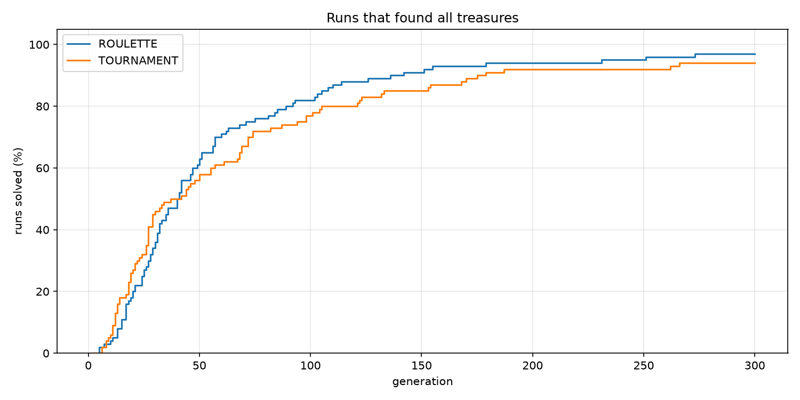

Roulette solved 97 % of the runs, tournament (size 3) 94 %; tournament is faster at the start (median 32.5 vs 40
generations) and finds shorter paths (38 vs 44 moves). Too much selection pressure is **not** the reason – the [tournament-size comparison](#tournament-size) shows that a tournament of 5 does better than
roulette; a tournament of 3 is simply too weak.

### Tournament size

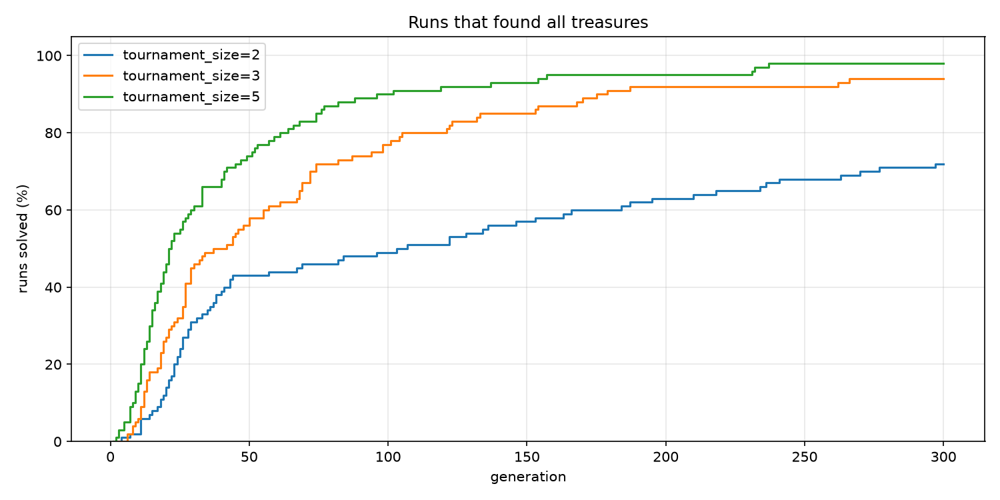

The clearest effect of all comparisons: **the larger the tournament, the better on every measure.** Size 5 solved
98 % of the runs with a median of 21 generations, size 3 94 % (32.5), size 2 only 72 % (37.5), and the size-2 curve
keeps rising slowly until the end. A larger tournament makes it more likely that the best programs become parents
(the population average at generation 50 rises from 2.25 to 2.62 to 2.92). With a tournament of 2, a parent only has
to beat one random opponent, so average programs become parents almost as often as good ones and improvements spread
too slowly. Larger tournaments also find shorter paths
(44.5 → 38 → 35 moves), because a tournament compares by order, so even one move less decides.

### Crossover

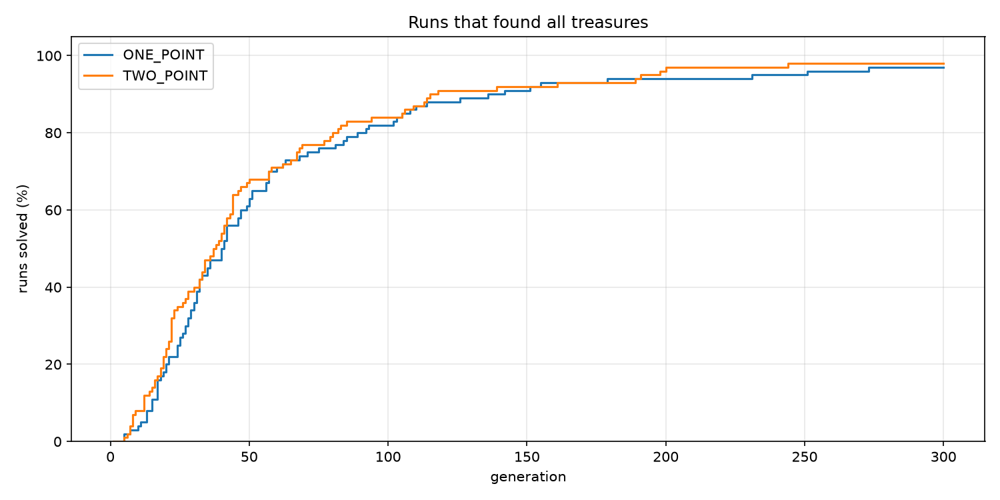

**No real difference:** 97 % vs 98 % solved, median 40 vs 37 generations, 44 vs 46 moves – all within random
variation. Both operators keep long blocks of cells together, so loops and the jumps inside them usually survive.
The cut positions are random in both cases, which makes the two operators behave very similarly on 64-cell programs.

### Elitism

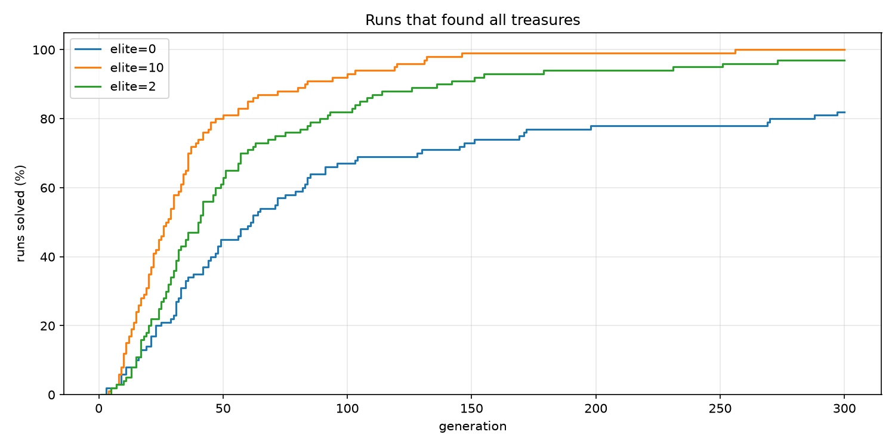

Elitism has a large effect. **Without it only 82 % of the runs succeed** and the solutions are the longest (57 moves).
Crossover and mutation almost always damage a good program, so without elitism the best program found so far can
simply disappear from the population, and the run has to find it again. Keeping 2 programs is already enough for
97 %; **keeping 10** gives **100 %** and a median of 27.5 generations – several good, different programs survive, and
crossover can combine them.

### Mutation

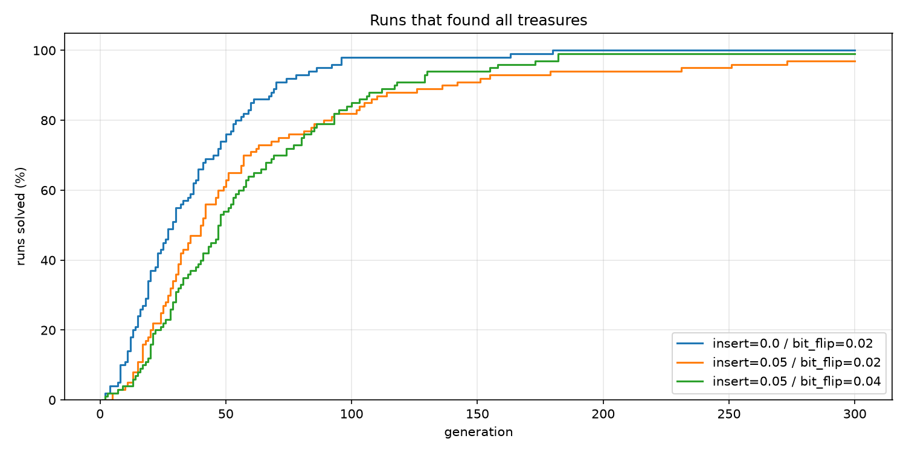

- **Without the structural mutations** (swap, insert, delete) **every run succeeded** and the median dropped from 40
  to 29 generations. Insert and delete shift all the following cells by one, which breaks every jump target and
  address in that part of the program – most such children are much worse than their parents. Per-cell mutations
  change only one cell and are enough to explore.
- **Doubling the per-cell rates** (bit flip 0.04, random cell 0.02, invert 0.01) keeps the success rate (99 %) but
  slows the search (median 47) and gives longer paths (50 moves): more children are damaged, and the population
  average at generation 50 falls to 1.76 from 2.05.

### Initialization

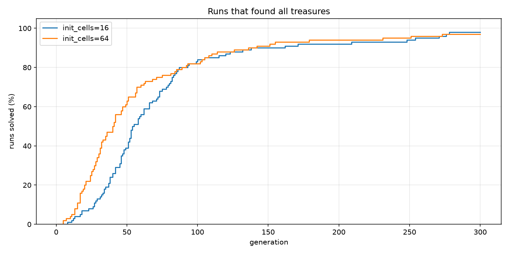

With only the first 16 cells random, the start is clearly slower – 8 % of the runs solved by generation 25 vs 27 %,
median 54 vs 40 generations. The remaining 48 cells are zero, and `00000000` is the instruction `INC 0`, so the end
of every program is a long block of useless increments; the first generation contains fewer working programs. The
final success rate is the same (98 % vs 97 %): mutation fills the empty cells over time.

### End of memory

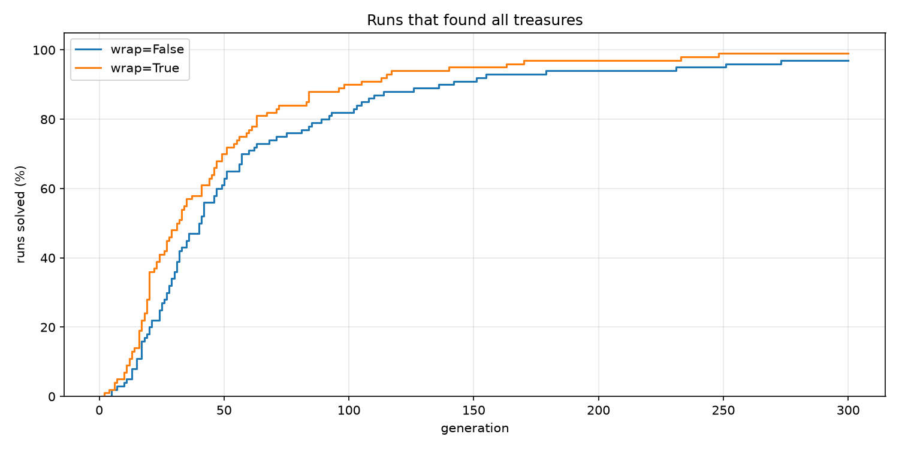

Letting the program continue from address 0 after the last cell (`--wrap`) helps: 99 % solved, median 31 vs 40
generations. With wrap-around every program is a loop, so a short sequence of writes can produce a long walk
without evolving a working `JMP` first. The paths are slightly longer (48 vs 44 moves), probably because looping
programs tend to repeat the same moves.

### Combined

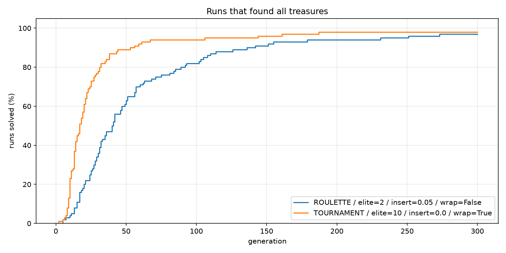

The best variant of each comparison together – tournament of 5, elite 10, no swap / insert / delete, wrap – is by far
the fastest configuration: **median 17 generations instead of 40, 73 % of the runs solved by generation 25 instead of
27 %, 89 % by generation 50 instead of 63 %.** The final success rate stays at the default level (98 % vs 97 %; two
runs were still unsolved after 300 generations), so the combination mainly makes the search faster rather than more
reliable. On new seeds it solved all 100 runs – see [Best configuration](#best-configuration).

### Conclusions

1. **Selection pressure and elitism matter most.** Larger tournaments and more elites make the search faster and
   more reliable; without elitism, good programs get lost.
2. **Mutations should be small.** Changing single cells works; inserting or deleting cells shifts addresses and
   damages programs, and higher rates slow the search down.
3. **The program representation matters.** Wrap-around and fully random initial programs make working programs
   easier to find.
4. **The crossover type does not matter** for this problem.

## Best configuration

The [comparison of methods](#comparison-of-methods) picked the best variant of every setting. Together they give:

```sh
uv run project2.py --selection tournament --tournament-size 5 --elite 10 --swap 0 --insert 0 --delete 0 --wrap
```

These settings were chosen on seeds 1–100, so their result on exactly those seeds may be a little optimistic.
`experiment.py` therefore runs them again on **100 new seeds (1001–1100)**, next to the default settings, and once
more with `--find-best` to see how short the paths get. The numbers below are from the run on 30 October 2026:

| Configuration | Solved | Solved by gen. 25 | Solved by gen. 50 | Gens median | Gens mean | Score | Moves median |
| --- | --- | --- | --- | --- | --- | --- | --- |
| **best** | **100 %** | **74 %** | **92 %** | **16** | **24.0** | **24.0** | 40 |
| best + find-best | 100 % | 74 % | 92 % | 16 | 24.0 | 24.0 | **18** |
| default | 96 % | 34 % | 66 % | 32 | 43.9 | 54.1 | 44 |

*Gens* and *moves* count only solved runs. The *score* combines speed and reliability: it is the mean number of
generations to find all treasures, where an unsolved run counts as 300 (the generation limit). Lower is better.

On the new seeds the best configuration does even better than on seeds 1–100, where 2 of its runs stayed unsolved:
**every run found all treasures, half of them within 16 generations**, and its score is less than half of the
default's. The choice holds on seeds it has never seen.

### Fitness over generations – `plots/fitness.png`

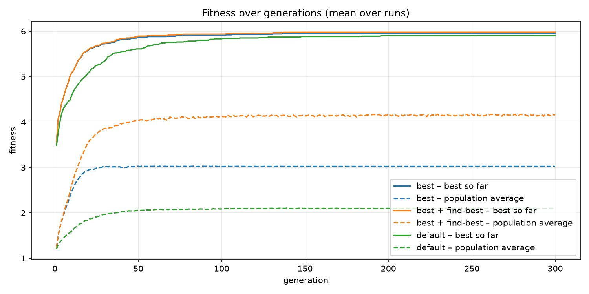

**How to read it.** Each line is a mean over all runs of a group. The solid line is the best fitness found so far,
the dashed line the average fitness of the whole population. The whole-number part is roughly *treasures found + 1*,
so 6 means all treasures; a mean between two whole numbers means the runs disagree (5.5 ≈ half of the runs have all
treasures). Runs that finished early keep their last value until the end of the graph.

**What it shows.**

- **The best configuration climbs faster.** Already the random first generation finds 2–3 treasures (mean best
  fitness about 3.5 in all groups). By generation 10 the best configuration is at 5.08 against 4.58 for the default,
  by generation 25 at 5.67 against 5.25 – most of its runs have all treasures by then.
- **Its population average is higher** – about 3.0 against 2.1. A tournament of 5 and 10 elites push the population
  towards the best programs, and without insert/delete mutations fewer children are destroyed.
- **The flat dashed lines are runs that stopped.** Without `--find-best` a run ends at its first solution, and its
  population average stays frozen at that moment. With `--find-best` the run goes on: the population fills up with
  programs that find every treasure, and its average keeps rising to about 4.15.
- **The averages stay far below the best.** Most children of a good program are much worse – changing one byte can
  break a jump or a loop – so progress comes from the best individuals, not from the population as a whole.

### Runs that found all treasures – `plots/success.png`

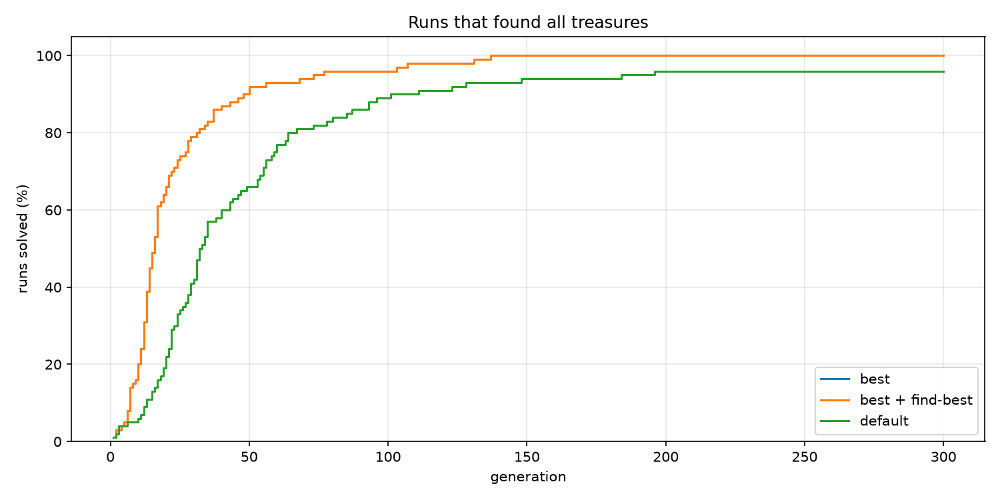

**How to read it.** The share of runs that had found all treasures by each generation; every step up is one run
reaching a solution. The higher and further left the curve, the better. Where a curve crosses 50 % is the
generation by which half of the runs are solved; its final height is the success rate within the generation limit.

**What it shows.**

- **The "best" line is hidden under "best + find-best".** Both use the same seeds, and the runs are identical until
  all treasures are found – `--find-best` only changes what happens after that.
- **The best configuration solves runs about twice as fast:** half of the runs by generation 16 against 32, 74 %
  against 34 % by generation 25, 92 % against 66 % by generation 50.
- **All 100 of its runs were solved by generation 137.** The default solved its last run in generation 196 and left
  4 runs unsolved after 300 generations.

### Solved runs – `plots/results.png`

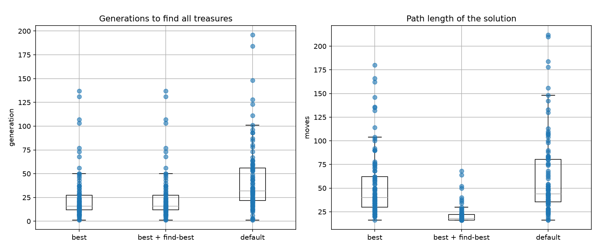

**How to read it.** Only runs that found all treasures. Left: the generation in which each run found them. Right: the
number of moves of that solution. Every dot is one run; the box holds the middle half of the runs, the line inside it
is the median and the whiskers show the usual range. A lower box is better, a narrower box means more predictable
behaviour.

**What it shows.**

- **Fewer generations and less spread.** The middle half of the best configuration's runs needed 12–27 generations,
  the default's 22–56.
- **The first solution is still long** – median 40 moves against 44 for the default. The configuration makes the
  search faster, but a run stops at the first path that collects every treasure, however long it is.
- **`--find-best` brings the paths close to the optimum:** median 18 moves, middle half 16–22, the longest 68.
  26 of the 100 runs found the shortest possible path (16 moves) and 69 have at most 20 moves. It costs time – every
  run uses all 300 generations, 5.2 s per run instead of 0.4 s.

**Summary.** The best configuration solved every run on new seeds, about twice as fast as the default settings.
Combined with `--find-best` it finds paths close to the shortest possible one.

## Design notes

- **Halting at the end of memory** is the default because a program that falls off its last cell is simply
  finished. `--wrap` lets programs loop around instead; the 500-step limit still applies.
- **Last two bits for `WRT`.** All four directions are equally likely for a random byte, and a single `INC`/`DEC`
  changes the direction – this makes self-modifying loops that "steer" the hunter easy to evolve.
- **Stop at the first solution** is what the assignment asks for. That path is usually far from the shortest one
  (the shortest path on `grid.txt` has 16 moves); `--find-best` keeps evolving and the fitness term
  `− 0.001 × moves` then shortens the path.
- **Insert and delete mutations shift every later cell**, which breaks jump targets and addresses in that part of the
  program. They help the program change its structure, but are much more destructive than the per-cell mutations –
  try `--insert 0 --delete 0` to compare.
- **Reproducibility.** Every random choice uses one seeded generator, so the same seed and settings always give the
  same run. The seed is printed at the start and stored in the log.
